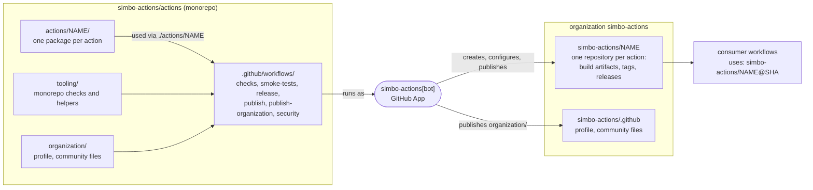
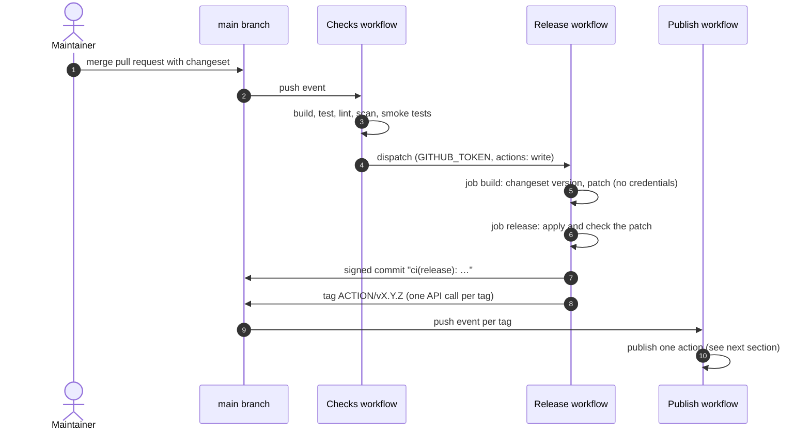
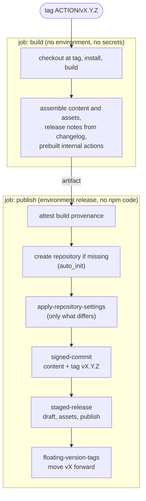
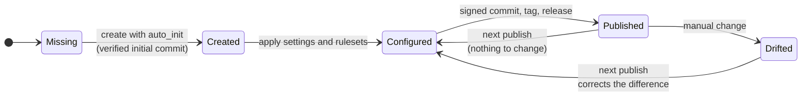
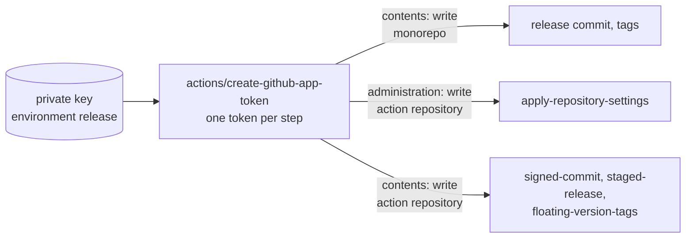
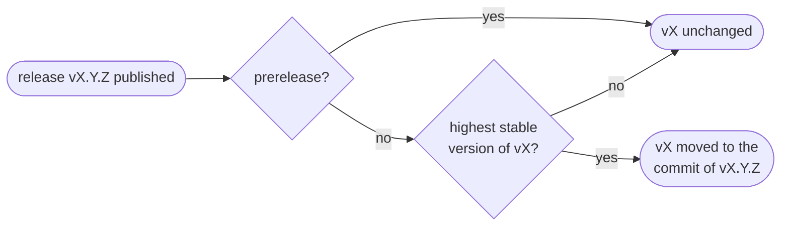
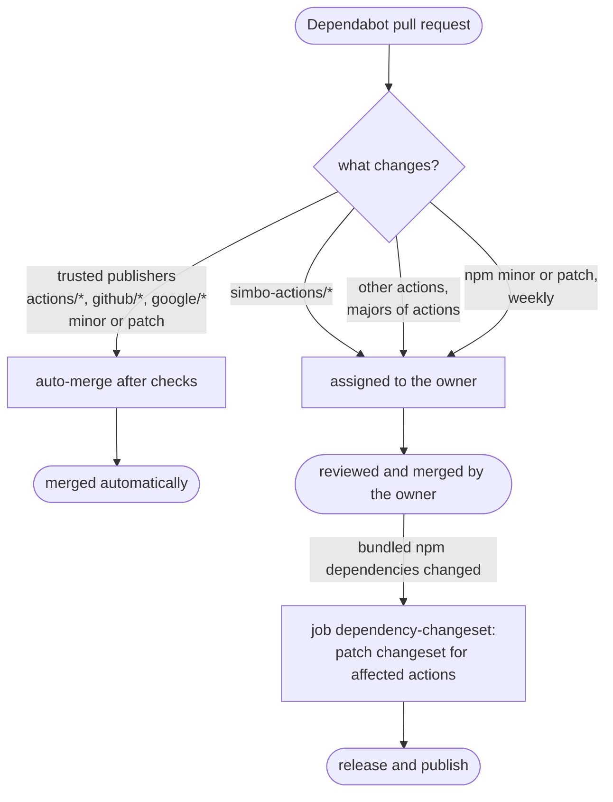

# 🔄 Simbo's Actions — Architecture

How this monorepo develops, releases, and publishes GitHub Actions, and how it
manages the action repositories in the organization
[`simbo-actions`](https://github.com/simbo-actions).

- The quality and security requirements: [STANDARDS.md](STANDARDS.md)
- Local development: [DEVELOPMENT.md](DEVELOPMENT.md)

## Contents

- [Why](#why)
- [Overview](#overview)
- [Repositories](#repositories)
- [Integration Tests](#integration-tests)
- [From Changeset to Release](#from-changeset-to-release)
- [Publishing an Action](#publishing-an-action)
- [Managing Action Repositories](#managing-action-repositories)
- [Organization Repository](#organization-repository)
- [GitHub App](#github-app)
- [Identity, Tokens, and Permissions](#identity-tokens-and-permissions)
- [Trust Boundaries](#trust-boundaries)
- [Tags and Versions](#tags-and-versions)
- [Dependency Updates](#dependency-updates)
- [Vulnerability, Secret, and License Checks](#vulnerability-secret-and-license-checks)
- [Rate Limits](#rate-limits)
- [Marketplace](#marketplace)
- [Node.js Runtime](#nodejs-runtime)
- [Design Decisions](#design-decisions)

## Why

A JavaScript action must ship its build in its repository, and consumers expect
moving version tags like `v1`.

Done by hand, every release means, for every action:

- building
- committing the build
- tagging
- creating the release
- moving the tags

That is tedious and error-prone, and it happens exactly where an attacker would
like to slip in a change: a workflow that runs an action executes whatever its
tag points to.

This monorepo automates all of it from one source.  
Actions are developed and tested here. A release builds them in CI and then:

- commits the build to the action repository as a verified commit,
- creates the version tag and the release with build provenance,
- moves the floating tag forward.

Only the release process writes to an action repository, with short-lived tokens
of a GitHub App.

## Overview

All actions are developed in one place and published to repositories of their
own.  
Consumers only use the action repositories, pinned by commit SHA.



## Repositories

| Repository               | Contains                                                                         | Changed by                           |
| ------------------------ | -------------------------------------------------------------------------------- | ------------------------------------ |
| `simbo-actions/actions`  | Source, tests, and docs of all actions; tooling; workflows                       | Maintainers and contributors via PRs |
| `simbo-actions/<action>` | Build artifacts of one action: `action.yml`, `dist/`, README, changelog, license | Only the publish workflow            |
| `simbo-actions/sandbox`  | Nothing permanent: the target of the integration tests of the write actions      | Only the workflow `smoke-tests`      |

The action repositories have issues, pull requests, discussions, wiki, and
projects disabled.  
Every action README starts with a note that points to the monorepo; issues and
contributions go there.

Workspaces in the monorepo:

| Workspace         | Purpose                                                        |
| ----------------- | -------------------------------------------------------------- |
| `actions/<name>/` | One action: `action.yml`, `src/`, tests, README, `LICENSE.md`  |
| `tooling/`        | Monorepo-specific checks and helpers, with tests               |
| `changelog/`      | Changelog of the monorepo itself                               |
| `organization/`   | Content of the organization repository `simbo-actions/.github` |

The release and publish workflows use the actions of this repository, built in
the same run: they publish themselves with
[`signed-commit`](actions/signed-commit/README.md),
[`apply-repository-settings`](actions/apply-repository-settings/README.md),
[`staged-release`](actions/staged-release/README.md), and
[`floating-version-tags`](actions/floating-version-tags/README.md).

Every action in `actions/<name>/` is published to `simbo-actions/<name>`.

## Integration Tests

The workflow `smoke-tests` tests the built actions against the real API, one job
per action, before every release:

- **Read-only tests** run on every pull request and push, without secrets, for
  example dry runs against public repositories.
- **Write tests** run only on `main`, in the environment `smoke-test`, against
  the repository
  [`simbo-actions/sandbox`](https://github.com/simbo-actions/sandbox):
  - `apply-repository-settings` creates and configures the sandbox like an
    action repository, checks that a second run changes nothing, and creates and
    renames a label;
  - `signed-commit` commits to a new branch with a file pattern, commits on top,
    and tags the head without changes;
  - `staged-release` publishes a release with an asset and generated notes and
    skips it in a re-run;
  - `floating-version-tags` creates and moves an annotated `v1`.

Like the privileged jobs of the release, the write tests run only prebuilt
actions and no npm code, and every token is restricted to the sandbox.  
The sandbox keeps no history of the tests:

- nothing is committed to its `main`, which holds only the initial commit of
  `auto_init`;
- every job removes its branches, tags, releases, and labels, also when it
  fails;
- the job `sandbox` first removes what an earlier run left behind, for example
  when a runner was lost, so that every run starts clean.

What stays are the settings and rulesets, applied the same way on every run.

## From Changeset to Release

Every change to an action comes with a changeset.  
A push to `main` with changesets starts the release automatically.



The release commit and the tags are created via the GitHub API with
[`signed-commit`](actions/signed-commit/README.md), so they are verified.  
The tag `changelog/vX.Y.Z` of the monorepo changelog starts no publish run.

## Publishing an Action

One publish run per tag `<action>/vX.Y.Z`; the tag names the action and its
repository `simbo-actions/<action>`.



Third-party code (install, build) runs only in the job `build`, which has no
environment and no secrets.  
The job `publish` downloads its artifact and runs the prebuilt actions; it runs
no npm code, which `pnpm run check:actions` checks for every job with an
environment.  
Each step requests its own token, see
[Identity, Tokens, and Permissions](#identity-tokens-and-permissions).

The same split applies to `release`, `publish-organization`, and the changeset
for dependency updates in `checks`.  
In `release`, the build job hands over a patch; the privileged job applies it
and fails if it touches anything but the files a release changes.

Release assets and how to verify them:

| Asset                          | Content                                                      |
| ------------------------------ | ------------------------------------------------------------ |
| `<action>-vX.Y.Z.tar.gz`       | The published content of the release                         |
| `SHA256SUMS`                   | SHA-256 checksum of the archive                              |
| Build provenance (attestation) | Signed statement that the archive was built by this workflow |

```sh
gh attestation verify signed-commit-v1.0.0.tar.gz --repo simbo-actions/actions
```

## Managing Action Repositories

The publish process owns the action repositories.  
It creates a missing repository and, on every publish, applies the settings in
[`.github/managed-repository-settings.yml`](.github/managed-repository-settings.yml)
with [`apply-repository-settings`](actions/apply-repository-settings/README.md):
it compares them with the current state and corrects what differs.  
The file is YAML, with comments that explain the choices.

Manual changes in an action repository are reset by the next publish.



Settings applied to every action repository:

| Area                   | Setting                                                                                                                                                         |
| ---------------------- | --------------------------------------------------------------------------------------------------------------------------------------------------------------- |
| General                | Issues, pull requests, discussions, wiki, and projects off; description from `package.json`; homepage is the monorepo; topics `github-actions`, `simbo-actions` |
| Merge                  | Squash only, auto-merge allowed, update branch suggested, branches deleted after merge                                                                          |
| Security               | Secret scanning with push protection, Dependabot alerts, private vulnerability reporting on                                                                     |
|                        | Dependabot security updates and code scanning off: the content is generated and overwritten by every publish; the source is scanned in the monorepo             |
| Actions                | SHA pinning required, `GITHUB_TOKEN` read-only, no pull request approvals                                                                                       |
| Ruleset "Main Branch"  | No deletion, no force push, linear history, signed commits, pull requests with squash only                                                                      |
| Ruleset "Release Tags" | `v*` (release and floating tags): creating, updating, and deleting only via bypass                                                                              |
| Bypass                 | The app `simbo-actions` and organization admins                                                                                                                 |
| Releases               | Immutable releases (switched on once the process is established)                                                                                                |

## Organization Repository

The repository
[`simbo-actions/.github`](https://github.com/simbo-actions/.github) holds:

- the organization profile (`profile/README.md`, shown on
  [github.com/simbo-actions](https://github.com/simbo-actions));
- the default community files, which GitHub shows in every repository of the
  organization without its own: `CONTRIBUTING.md`, `SECURITY.md`, `SUPPORT.md`,
  `CODE_OF_CONDUCT.md`. They all point to this monorepo.

The content lives in [`organization/`](organization/README.md).  
The workflow `publish-organization` publishes it on every change on `main`, the
same way as an action:

- it creates the repository if missing,
- applies the settings of `.github/managed-repository-settings.yml`,
- and commits the content with `signed-commit`.

The list of actions in the profile is generated with `pnpm run actions-list`.  
The release workflow updates it in every release commit, so the profile shows
the latest versions.

## GitHub App

All automation that writes in the organization acts as one GitHub App,
`simbo-actions[bot]`.  
No personal tokens are used.

| Aspect                 | Setting                                                                                                                                                                                      |
| ---------------------- | -------------------------------------------------------------------------------------------------------------------------------------------------------------------------------------------- |
| Installation           | Organization `simbo-actions`, all repositories: the publish process creates new repositories, which must be covered without manual steps                                                     |
| Repository permissions | `administration: write` to create and configure action repositories; `contents: write` for commits, tags, and releases; `issues: write` for the label tests in the sandbox; `metadata: read` |
| Not granted            | `workflows` (no step writes workflow files), all organization permissions, webhooks and events                                                                                               |
| Credentials            | In both environments `release` and `smoke-test`: the private key as secret (`SIMBO_ACTIONS_APP_PRIVATE_KEY`), the client ID as variable (`SIMBO_ACTIONS_APP_CLIENT_ID`)                      |
| Rulesets               | Bypass actor in the rulesets of the monorepo and of every action repository, together with organization admins                                                                               |

Two levels limit what a token can do:

- the installation permissions are the maximum;
- every step requests only a part of them, for one repository, see
  [Identity, Tokens, and Permissions](#identity-tokens-and-permissions).

- A permission is added to the installation only together with the step that
  needs it, and documented here.
- The private key is rotated yearly, and immediately if it may have leaked; see
  [MAINTAINING.md](MAINTAINING.md).

## Identity, Tokens, and Permissions

Release and publish run as the GitHub App `simbo-actions[bot]`.  
Its private key lives in the environment `release`, which only `main` and
release tags can use, and in the environment `smoke-test` for the integration
tests, which only `main` can use.  
Every step requests its own token, restricted to one repository and the
permissions it needs.

| Step                             | Token          | Repository        | Permissions                                                         |
| -------------------------------- | -------------- | ----------------- | ------------------------------------------------------------------- |
| Checks (all jobs except below)   | `GITHUB_TOKEN` | monorepo          | `contents: read`                                                    |
| Dispatch release                 | `GITHUB_TOKEN` | monorepo          | `actions: write`                                                    |
| Release commit and tags          | app token      | monorepo          | `contents: write`                                                   |
| Changeset for dependency updates | app token      | monorepo          | `contents: write`                                                   |
| Create action repository         | app token      | monorepo (scope)  | `administration: write`, only if missing                            |
| Configure action repository      | app token      | action repository | `administration: write`                                             |
| Commit, tag, release             | app token      | action repository | `contents: write`                                                   |
| Publish organization repository  | app token      | `.github`         | `administration: write` (create, configure), then `contents: write` |
| Vulnerability scan (security)    | `GITHUB_TOKEN` | monorepo          | `security-events: write`                                            |
| Build jobs                       | `GITHUB_TOKEN` | monorepo          | `contents: read`, no environment                                    |
| Build provenance (publish job)   | `GITHUB_TOKEN` | monorepo          | `id-token: write`, `attestations: write`                            |
| Create sandbox (smoke tests)     | app token      | monorepo (scope)  | `administration: write`, only if missing                            |
| Configure sandbox, label tests   | app token      | sandbox           | `administration: write`, `issues: write`                            |
| Write tests (smoke tests)        | app token      | sandbox           | `contents: write`                                                   |



Tokens are revoked at the end of each job.  
No Git credentials are stored in a checkout; commits and tags are created via
the API.

## Trust Boundaries

| Context                                                   | Secrets | Can write to                               |
| --------------------------------------------------------- | ------- | ------------------------------------------ |
| Pull requests, Dependabot, forks                          | none    | nothing (read-only `GITHUB_TOKEN`)         |
| Push to `main` (checks)                                   | none    | dispatches the release only                |
| Build jobs of release and publish                         | none    | nothing; they hand over an artifact        |
| Jobs with environment `release` on `main` or release tags | app key | monorepo and action repositories, per step |
| Jobs with environment `smoke-test` on `main`              | app key | the sandbox only                           |
| Organization admins                                       | –       | everything, via ruleset bypass             |

Jobs with an environment run no npm code: a process started by a dependency
during install or build could otherwise read the private key from a later step
on the same runner.  
Remaining risk: a compromised build tool could change the prebuilt actions that
the privileged job runs with a short-lived, narrowly scoped token. Using the
published actions, pinned by SHA, instead of the ones built in the same run
removes this risk; it is planned.

Fork pull requests need approval before their workflows run.  
The rulesets apply to all automation; only the app and organization admins
bypass them.

## Tags and Versions

| Where             | Tag                | Created by       |
| ----------------- | ------------------ | ---------------- |
| Monorepo          | `<action>/vX.Y.Z`  | Release workflow |
| Monorepo          | `changelog/vX.Y.Z` | Release workflow |
| Action repository | `vX.Y.Z`           | Publish workflow |
| Action repository | `vX` (floating)    | Publish workflow |

- Every action is versioned independently with semantic versioning.
- **Recommended:** consumers pin the commit SHA of a release tag, with the
  version as a comment; Dependabot updates such pins.  
  A SHA cannot change.
- **Convenience:** the floating tag `vX` points to the latest stable release of
  major version `X`.  
  It is moved only by the publish workflow, with
  [`floating-version-tags`](actions/floating-version-tags/README.md), and only
  forward: to the highest stable version of its line, never to a prerelease.  
  A re-run of an older release does not move it back.
- The floating tag is an annotated tag whose message names the release, for
  example `v1 → v1.4.2 (latest stable release of major version 1)`;
  `git show v1` shows it.  
  GitHub does not sign tag objects created via the API; the commit it points to
  is verified.
- There are no `vX.Y` or `latest` tags.
- Release and floating tags are protected by the ruleset "Release Tags"
  (`v*`).  
  With immutable releases, a published version is final; the floating tag is not
  part of a release and keeps moving.



## Dependency Updates

Dependabot proposes updates; what is merged automatically depends on the risk.



Updates of third-party actions and npm packages wait 7 days after their release
(cooldown).  
Dependabot pull requests never receive secrets; the changeset for npm updates is
created after the merge, in a job with the environment `release`.

- **Only bundled dependencies release an action.** The job compares the
  production dependencies of every action in `pnpm-lock.yaml` before and after
  the merge (`pnpm list --prod`); development dependencies cause no release.
- **`simbo-actions/*` updates are reviewed,** not merged automatically: the
  privileged jobs of this repository run these actions with the credentials of
  the app.
- **Auto-merge uses `GITHUB_TOKEN`,** so the merge starts no `checks` run on
  `main`. The checks ran on the pull request, the merge changes only workflow
  pins, and the weekly `security` run scans `main`. A token with more rights
  would need secrets in Dependabot workflows.
- Auto-merge requires that both the pull request and the event come from
  Dependabot (`github.actor`), and fails closed if the changed files cannot be
  read.

## Vulnerability, Secret, and License Checks

| Check                                        | Tool                                                                                                    | Scope                                   | Runs                                                                                                   |
| -------------------------------------------- | ------------------------------------------------------------------------------------------------------- | --------------------------------------- | ------------------------------------------------------------------------------------------------------ |
| Vulnerabilities and malicious packages       | [osv-scanner](https://github.com/google/osv-scanner) via Google's reusable workflows                    | all dependencies in `pnpm-lock.yaml`    | `checks` (pull requests: new findings only; `main`), weekly `security`, locally                        |
| Licenses allowed anywhere                    | osv-scanner (`--licenses`)                                                                              | all dependencies                        | `checks`, weekly `security`, locally                                                                   |
| Secrets                                      | [Gitleaks](https://github.com/gitleaks/gitleaks) via [`gitleaks-scan`](actions/gitleaks-scan/README.md) | new commits; the whole Git history      | `checks` (pull requests, `main`: their commits), weekly `security` (history), locally, pre-commit hook |
| Licenses allowed in bundled code             | [license-checker-rseidelsohn](https://github.com/RSeidelsohn/license-checker-rseidelsohn)               | production dependencies of every action | `checks`, locally                                                                                      |
| License file, README sections, monorepo note | `tooling/bin/check-actions.ts`, which also checks the Octokit copies and the license lists              | every action                            | `checks`, locally                                                                                      |

The osv-scanner workflows upload their results to code scanning.  
On pull requests, only findings that the pull request adds fail.  
The release is dispatched only after the scan on `main` passed.

The scan job has no secrets and only `contents: read` and
`security-events: write`.  
Remaining risk: Google's workflow runs a Docker image referenced by tag, not by
digest. It is accepted because the job cannot write code or reach secrets (see
[STANDARDS.md](STANDARDS.md), "strictness follows permissions").

`gitleaks-scan` runs in the job `checks` on the commits of the pull request or
push, and weekly in `security` on the whole history, so that new rules of a
newer Gitleaks version also check old commits.  
It reports findings as annotations and in the job summary, with secrets
redacted.  
False positives go into `.gitleaksignore`.

The allowed licenses appear in `package.json` and in the workflows;
`pnpm run check:actions` checks that they match.

Accepted findings are listed in [`osv-scanner.toml`](osv-scanner.toml), each
with a reason and an expiry date.  
Security fixes of indirect dependencies are set as `overrides` in
[`pnpm-workspace.yaml`](pnpm-workspace.yaml).

## Rate Limits

All API requests of release and publish run as `simbo-actions[bot]` and share
its rate limits, also across parallel runs.  
Settings of action repositories are written only where they differ, to save
write requests.

All actions create their API client with `createOctokit` from
`src/create-octokit.ts`, which uses the official plugin
`@octokit/plugin-throttling`: requests that hit a rate limit wait as long as
GitHub asks for and are retried up to 4 times.

Every action that uses the GitHub API has its own identical copy of
`create-octokit.ts`; `pnpm run check:actions` fails if the copies differ.  
The copies are temporary, until the client moves to a published package.

## Marketplace

Every published action can be listed in the
[GitHub Marketplace](https://github.com/marketplace?type=actions).  
Listing is a manual step after a release (edit the release, "Publish this Action
to the GitHub Marketplace"); not every patch version needs to be listed.

The names of the actions are free in the Marketplace, and the action
repositories meet its requirements: one `action.yml` at the root, no workflow
files.

## Node.js Runtime

The GitHub Actions runner sets the Node.js version: actions run with the runtime
named in `action.yml` (`using: node24`), and the runner offers only specific
versions.

Development and CI use the same major version (`.nvmrc`, `engines`,
`@types/node`), so that code and types match the runtime.  
When the runner offers a new runtime, all actions move to it together, each in a
major version; see [MAINTAINING.md](MAINTAINING.md).

## Design Decisions

- **One publish run per tag.** Why: every action publishes independently and can
  be re-run on its own.  
  Large releases share rate limits; a matrix with `max-parallel` is the option
  if that becomes a problem.
- **Commits and tags via the API.** Why: commits by a GitHub App are verified
  only when GitHub creates them; tags created one by one each trigger their own
  event.
- **Repositories created with `auto_init`.** Why: the initial commit is created
  by GitHub and verified.  
  Creating repositories from a template repository is an option if they should
  start with fixed files; settings and rulesets would still be applied by the
  publish process.
- **One `LICENSE.md` per action.** Why: the copyright year is the year an action
  was first published; a shared file would change the year of older actions.
- **Settings enforced on every publish.** Why: action repositories are
  generated; drift is corrected automatically instead of documented.
- **The release process uses its own actions.** Why: every release exercises the
  actions it publishes; a broken action fails the release before consumers see
  it.
- **Separate jobs for build and credentials.** Why: steps of one job share the
  runner, so a process started by a dependency in an earlier step could read
  secrets of a later step. A job without secrets builds; a job without npm code
  uses the credentials.
- **No reusable workflows across repositories.** Why: actions are versioned,
  tested, and pinned like any dependency; workflows stay in each repository and
  readable on their own.  
  Within this repository, a workflow may call another one to keep it readable:
  `checks` calls `smoke-tests`, at the same commit, so nothing needs a pin and
  the release waits for the smoke tests.  
  Reusable workflows of trusted publishers are used in read-only jobs, such as
  Google's osv-scanner workflows.
- **YAML for configuration.** Why: it allows comments that explain a setting
  next to it. It is read strictly, without duplicate keys, anchors, aliases, or
  tags, so that every value is what the file shows; JSON stays valid YAML.  
  Configurations of tools that require JSON stay JSON, for example
  `.changeset/config.json`.
- **Octokit client copied into every action.** Why: an unpublished shared
  package has no version, changelog, or release of its own.  
  The copies are identical, checked by `pnpm run check:actions`, until the
  client moves to a published package.
