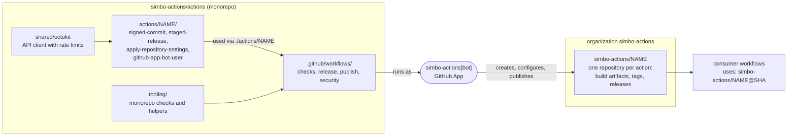
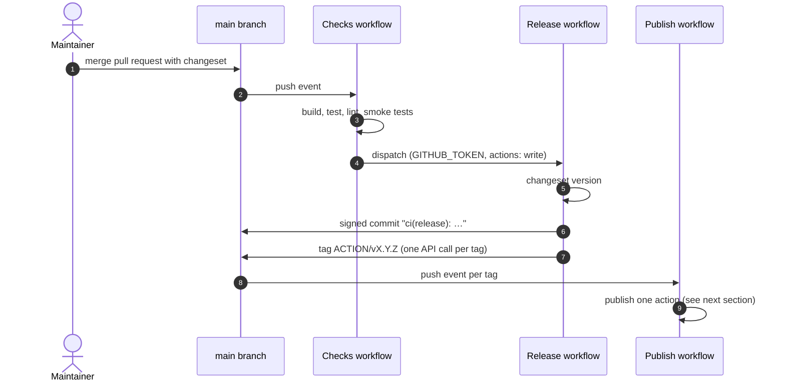
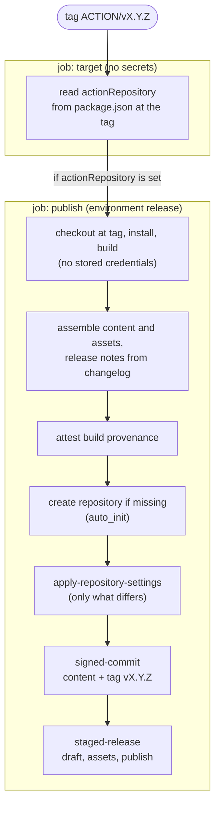
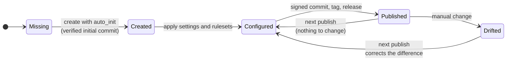
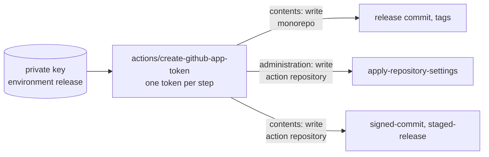
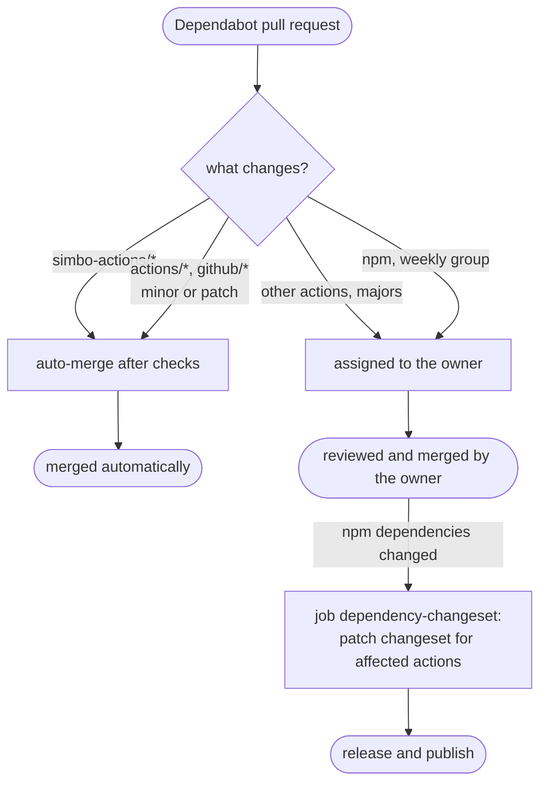

# 🔄 Simbo's Actions — Architecture

How this monorepo develops, releases, and publishes GitHub Actions, and how it
manages the action repositories in the organization
[`simbo-actions`](https://github.com/simbo-actions).

For the quality and security requirements, see [STANDARDS.md](STANDARDS.md). For
local development, see [DEVELOPMENT.md](DEVELOPMENT.md).

## Contents

- [Overview](#overview)
- [Repositories](#repositories)
- [From Changeset to Release](#from-changeset-to-release)
- [Publishing an Action](#publishing-an-action)
- [Managing Action Repositories](#managing-action-repositories)
- [GitHub App](#github-app)
- [Identity, Tokens, and Permissions](#identity-tokens-and-permissions)
- [Trust Boundaries](#trust-boundaries)
- [Tags and Versions](#tags-and-versions)
- [Dependency Updates](#dependency-updates)
- [Vulnerability and License Checks](#vulnerability-and-license-checks)
- [Rate Limits](#rate-limits)
- [Marketplace](#marketplace)
- [Node.js Runtime](#nodejs-runtime)
- [Design Decisions](#design-decisions)

## Overview

All actions are developed in one place and published to repositories of their
own. Consumers only use the action repositories, pinned by commit SHA.



## Repositories

| Repository               | Contains                                                                         | Changed by                           |
| ------------------------ | -------------------------------------------------------------------------------- | ------------------------------------ |
| `simbo-actions/actions`  | Source, tests, and docs of all actions; shared code; tooling; workflows          | Maintainers and contributors via PRs |
| `simbo-actions/<action>` | Build artifacts of one action: `action.yml`, `dist/`, README, changelog, license | Only the publish workflow            |

The action repositories have issues, wiki, and projects disabled. Issues and
contributions go to the monorepo.

Workspaces in the monorepo:

| Workspace         | Purpose                                                       |
| ----------------- | ------------------------------------------------------------- |
| `actions/<name>/` | One action: `action.yml`, `src/`, tests, README, `LICENSE.md` |
| `shared/<name>/`  | Code shared by actions and bundled into them, not published   |
| `tooling/`        | Monorepo-specific checks and helpers, with tests              |
| `changelog/`      | Changelog of the monorepo itself                              |

The release and publish workflows use the actions of this repository via
`./actions/<name>`: they publish themselves with
[`signed-commit`](actions/signed-commit/README.md),
[`apply-repository-settings`](actions/apply-repository-settings/README.md), and
[`staged-release`](actions/staged-release/README.md).

An action is published only if its `package.json` names the target repository in
`actionRepository`, for example
`"actionRepository": "simbo-actions/signed-commit"`.

## From Changeset to Release

Every change to an action comes with a changeset. A push to `main` with
changesets starts the release automatically.



The release commit and the tags are created via the GitHub API with
[`signed-commit`](actions/signed-commit/README.md), so they are verified. The
tag `changelog/vX.Y.Z` of the monorepo changelog starts no publish run.

## Publishing an Action

One publish run per tag `<action>/vX.Y.Z`. A first job without secrets decides
whether the action is published at all.



Actions without `actionRepository` are not published; their publish job is
skipped.

All third-party code (install, build) runs before the first app token is
requested. Each later step requests its own token, see
[Identity, Tokens, and Permissions](#identity-tokens-and-permissions).

Release assets and how to verify them:

| Asset                          | Content                                                      |
| ------------------------------ | ------------------------------------------------------------ |
| `<action>-vX.Y.Z.tar.gz`       | The published content of the release                         |
| `SHA256SUMS`                   | SHA-256 checksum of the archive                              |
| Build provenance (attestation) | Signed statement that the archive was built by this workflow |

```sh
gh attestation verify signed-commit-v1.0.0.tar.gz --repo simbo-actions/actions
```

## Managing Action Repositories

The publish process owns the action repositories. It creates a missing
repository and, on every publish, applies the settings in
[`.github/action-repository-settings.json`](.github/action-repository-settings.json)
with [`apply-repository-settings`](actions/apply-repository-settings/README.md):
it compares them with the current state and corrects what differs. Manual
changes in an action repository are reset by the next publish.



Settings applied to every action repository:

| Area                   | Setting                                                                                                                                             |
| ---------------------- | --------------------------------------------------------------------------------------------------------------------------------------------------- |
| General                | Issues, wiki, and projects off; description from `package.json`; homepage is the monorepo                                                           |
| Merge                  | Squash only, auto-merge allowed, update branch suggested, branches deleted after merge                                                              |
| Security               | Secret scanning with push protection, Dependabot alerts, private vulnerability reporting on                                                         |
|                        | Dependabot security updates and code scanning off: the content is generated and overwritten by every publish; the source is scanned in the monorepo |
| Actions                | SHA pinning required, `GITHUB_TOKEN` read-only, no pull request approvals                                                                           |
| Ruleset "Main Branch"  | No deletion, no force push, linear history, signed commits, pull requests with squash only                                                          |
| Ruleset "Release Tags" | `v*.*.*`: creating, updating, and deleting only via bypass                                                                                          |
| Bypass                 | The app `simbo-actions` and organization admins                                                                                                     |
| Releases               | Immutable releases (switched on once the process is established)                                                                                    |

## GitHub App

All automation that writes in the organization acts as one GitHub App,
`simbo-actions[bot]`. No personal tokens are used.

| Aspect                 | Setting                                                                                                                                  |
| ---------------------- | ---------------------------------------------------------------------------------------------------------------------------------------- |
| Installation           | Organization `simbo-actions`, all repositories: the publish process creates new repositories, which must be covered without manual steps |
| Repository permissions | `administration: write` to create and configure action repositories; `contents: write` for commits, tags, and releases; `metadata: read` |
| Not granted            | `workflows` (no step writes workflow files), all organization permissions, webhooks and events                                           |
| Credentials            | Private key in the environment `release` (`SIMBO_ACTIONS_APP_PRIVATE_KEY`), client ID as variable (`SIMBO_ACTIONS_APP_CLIENT_ID`)        |
| Rulesets               | Bypass actor in the rulesets of the monorepo and of every action repository, together with organization admins                           |

Two levels limit what a token can do: the installation permissions are the
maximum; every step requests only a part of them, for one repository, see
[Identity, Tokens, and Permissions](#identity-tokens-and-permissions).

- A permission is added to the installation only together with the step that
  needs it, and documented here.
- The private key is rotated yearly, and immediately if it may have leaked; see
  [MAINTAINING.md](MAINTAINING.md).

## Identity, Tokens, and Permissions

Release and publish run as the GitHub App `simbo-actions[bot]`. Its private key
lives in the environment `release`, which only `main` and release tags can use.
Every step requests its own token, restricted to one repository and the
permissions it needs.

| Step                             | Token          | Repository        | Permissions                              |
| -------------------------------- | -------------- | ----------------- | ---------------------------------------- |
| Checks (all jobs except below)   | `GITHUB_TOKEN` | monorepo          | `contents: read`                         |
| Dispatch release                 | `GITHUB_TOKEN` | monorepo          | `actions: write`                         |
| Release commit and tags          | app token      | monorepo          | `contents: write`                        |
| Changeset for dependency updates | app token      | monorepo          | `contents: write`                        |
| Create action repository         | app token      | monorepo (scope)  | `administration: write`, only if missing |
| Configure action repository      | app token      | action repository | `administration: write`                  |
| Commit, tag, release             | app token      | action repository | `contents: write`                        |
| Vulnerability scan (security)    | `GITHUB_TOKEN` | monorepo          | `security-events: write`                 |
| Build provenance                 | `GITHUB_TOKEN` | monorepo          | `id-token: write`, `attestations: write` |



Tokens are revoked at the end of each job. No Git credentials are stored in a
checkout; commits and tags are created via the API.

## Trust Boundaries

| Context                                                   | Secrets | Can write to                               |
| --------------------------------------------------------- | ------- | ------------------------------------------ |
| Pull requests, Dependabot, forks                          | none    | nothing (read-only `GITHUB_TOKEN`)         |
| Push to `main` (checks)                                   | none    | dispatches the release only                |
| Jobs with environment `release` on `main` or release tags | app key | monorepo and action repositories, per step |
| Organization admins                                       | –       | everything, via ruleset bypass             |

Fork pull requests need approval before their workflows run. The rulesets apply
to all automation; only the app and organization admins bypass them.

## Tags and Versions

| Where             | Tag                | Created by       |
| ----------------- | ------------------ | ---------------- |
| Monorepo          | `<action>/vX.Y.Z`  | Release workflow |
| Monorepo          | `changelog/vX.Y.Z` | Release workflow |
| Action repository | `vX.Y.Z`           | Publish workflow |

- Every action is versioned independently with semantic versioning.
- There are no moving tags such as `vX`, `vX.Y`, or `latest`. Consumers pin the
  commit SHA of a release tag, with the version as a comment; Dependabot updates
  such pins.
- Release tags are protected by the ruleset "Release Tags". With immutable
  releases, a published version is final.

## Dependency Updates

Dependabot proposes updates; what is merged automatically depends on the risk.



Updates of third-party actions and npm packages wait 7 days after their release
(cooldown). Dependabot pull requests never receive secrets; the changeset for
npm updates is created after the merge, in a job with the environment `release`.

## Vulnerability and License Checks

| Check                                  | Tool                                                                                      | Scope                                   | Runs                                                         |
| -------------------------------------- | ----------------------------------------------------------------------------------------- | --------------------------------------- | ------------------------------------------------------------ |
| Vulnerabilities and malicious packages | [osv-scanner](https://github.com/google/osv-scanner), pinned with checksum                | all dependencies in `pnpm-lock.yaml`    | `checks` (pull requests, `main`), weekly `security`, locally |
| Licenses allowed anywhere              | osv-scanner (`--licenses`)                                                                | all dependencies                        | `checks`, locally                                            |
| Licenses allowed in bundled code       | [license-checker-rseidelsohn](https://github.com/RSeidelsohn/license-checker-rseidelsohn) | production dependencies of every action | `checks`, locally                                            |
| License file per action                | `tooling/bin/check-action-licenses.ts`                                                    | every action                            | `checks`, locally                                            |

The workflow `security` uploads the results of osv-scanner to code scanning.
Accepted findings are listed in [`osv-scanner.toml`](osv-scanner.toml), each
with a reason and an expiry date; security fixes of indirect dependencies are
set as `overrides` in [`pnpm-workspace.yaml`](pnpm-workspace.yaml).

## Rate Limits

All API requests of release and publish run as `simbo-actions[bot]` and share
its rate limits, also across parallel runs. All actions create their API client
with [`shared/octokit`](shared/octokit/README.md), which uses the official
plugin `@octokit/plugin-throttling`: requests that hit a rate limit wait as long
as GitHub asks for and are retried up to 4 times. Settings of action
repositories are written only where they differ, to save write requests.

## Marketplace

Every published action can be listed in the
[GitHub Marketplace](https://github.com/marketplace?type=actions). Listing is a
manual step after a release (edit the release, "Publish this Action to the
GitHub Marketplace"); not every patch version needs to be listed. The names of
the actions are free in the Marketplace, and the action repositories meet its
requirements: one `action.yml` at the root, no workflow files.

## Node.js Runtime

The GitHub Actions runner sets the Node.js version: actions run with the runtime
named in `action.yml` (`using: node24`), and the runner offers only specific
versions. Development and CI use the same major version (`.nvmrc`, `engines`,
`@types/node`), so that code and types match the runtime. When the runner offers
a new runtime, all actions move to it together, each in a major version; see
[MAINTAINING.md](MAINTAINING.md).

## Design Decisions

- **One publish run per tag.** Why: every action publishes independently and can
  be re-run on its own. Large releases share rate limits; a matrix with
  `max-parallel` is the option if that becomes a problem.
- **Commits and tags via the API.** Why: commits by a GitHub App are verified
  only when GitHub creates them; tags created one by one each trigger their own
  event.
- **Repositories created with `auto_init`.** Why: the initial commit is created
  by GitHub and verified. Creating repositories from a template repository is an
  option if they should start with fixed files; settings and rulesets would
  still be applied by the publish process.
- **One `LICENSE.md` per action.** Why: the copyright year is the year an action
  was first published; a shared file would change the year of older actions.
- **Settings enforced on every publish.** Why: action repositories are
  generated; drift is corrected automatically instead of documented.
- **The release process uses its own actions.** Why: every release exercises the
  actions it publishes; a broken action fails the release before consumers see
  it.
- **No reusable workflows.** Why: actions are versioned, tested, and pinned like
  any dependency; workflows stay in each repository and readable on their own.
