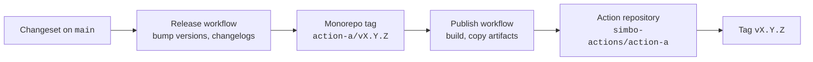

# 🔄 Simbo's Actions — Concept

The main goal of this monorepo setup is to develop all my GitHub Actions in a
centralized location while still publishing their build artifacts to separate
repositories.

## Key Features

- **Native GitHub Actions versioning:** Each action is versioned independently
  with semantic versioning. Every release gets a tag `vX.Y.Z` in the action's
  repository. There are no moving tags such as `vX`, `vX.Y`, or `latest`.

- **Pinning by SHA:** Consumers pin an action by the commit SHA of a release
  tag, with the version as a comment, for example
  `simbo-actions/<ACTION>@<SHA> # vX.Y.Z`. Dependabot updates such pins.

- **No build artifacts in this repository:** The monorepo only contains the
  source code of the actions. The built artifacts are published to their
  respective repositories, keeping this repository clean and focused on relevant
  source code.

- **Streamlined publishing:** Actions are published automatically to their
  respective repositories upon adding new changesets, simplifying the
  distribution process and lowering maintenance overhead.

## Release Process

1. A push to `main` runs the "Checks" workflow. If changesets are present, it
   dispatches the "Release" workflow.
2. "Release" integrates the changesets and creates a signed commit with the
   version bumps and changelogs on `main`, together with a tag `<action>/vX.Y.Z`
   per released package. Every tag is created on its own, so every tag triggers
   its own "Publish" run.
3. "Publish" builds the action and publishes it to its repository, if the action
   is meant to be published (see
   [Published and Unpublished Actions](#published-and-unpublished-actions)):
   1. Creates the repository if necessary and applies the standard settings and
      rulesets (on every publish).
   2. Replaces the content with the build artifacts and creates a signed commit
      with the tag `vX.Y.Z`.
   3. Creates a GitHub release as draft, uploads the assets
      (`<action>-vX.Y.Z.tar.gz` with the published content and `SHA256SUMS`),
      and publishes the release. The release notes are the version's section of
      the changelog.

All commits and tags are created via the GitHub API with
[`signed-commit`](actions/signed-commit/README.md), so they are verified.

### Published and Unpublished Actions

An action is published to its own repository only if its `package.json` names
the target in `actionRepository`, for example
`"actionRepository": "simbo-actions/signed-commit"`. The repository name must
match the workspace name.

Actions without `actionRepository` are released only in this monorepo, with the
tag `<action>/vX.Y.Z`. They are used from the monorepo, pinned by commit SHA,
for example `simbo-actions/actions/actions/<action>@<SHA>`.

### Identity and Permissions

Release and publish run as the GitHub App `simbo-actions[bot]`. Their jobs use
the environment `release`, which is limited to `main` and release tags. Every
step requests its own token, restricted to one repository and the permissions it
needs: `administration` only to create and configure an action repository,
otherwise `contents`.

Third-party code runs first: install and build finish before any app token is
requested, and no Git credentials are stored in a checkout.

### Rate Limits

All API requests of release and publish run as `simbo-actions[bot]` and share
its rate limits, also across parallel runs. Requests that hit a rate limit are
retried after the wait time GitHub asks for, both in `signed-commit` and in the
scripts in `.github/scripts/`.

### Settings of Action Repositories

The publish process applies these settings to every action repository. It reads
the current state first and writes only what differs, so manual changes are
reset without unnecessary write requests:

- Issues, wiki, and projects off; issues and contributions go to this
  repository.
- Squash merges only, auto-merge allowed, branches deleted after merge.
- Secret scanning with push protection, Dependabot alerts, and private
  vulnerability reporting on. Dependabot security updates and code scanning off:
  the content is generated and overwritten by every publish; the source is
  scanned in this repository.
- Actions: SHA pinning required, `GITHUB_TOKEN` read-only, no pull request
  approvals.
- Ruleset "Main Branch": no deletion, no force push, linear history, signed
  commits, pull requests with squash only.
- Ruleset "Release Tags" for `v*.*.*`: creating, updating, and deleting only via
  bypass.
- Bypass for both rulesets: the app `simbo-actions` and organization admins.

### New Action Repositories

A new action repository is created with `auto_init` and the description from the
action's `package.json`. GitHub creates the initial commit with a generated
`README.md`; that commit is verified. The first publish replaces the content.

Option, not used yet: create new repositories from a template repository, if
they should start with fixed files. Rulesets and settings are not copied from
templates and are still set by the publish process.

## Requirements for Action Workspaces

To be compatible with the management and publishing process, each action
workspace must meet the following requirements:

- A `README.md` file documenting the action's purpose, usage, and examples.

- An `action.yml` file defining the action's metadata and inputs/outputs.

- A `package.json` file defining the action's workspace/package name, version,
  scripts, dependencies, etc. _(This is required even for non-Node.js actions to
  manage the workspace/package structure.)_ To publish the action to its own
  repository, it must contain `actionRepository`.

- If the action is implemented in JavaScript/TypeScript:
  - It should target Node.js 24 as the runtime environment.

### Scripts Called in Workflows

An action workspace's `package.json` may define the following scripts, which are
called in the workflows:

- `build` - builds the action's source code into a distributable format.
- `bundle` - run post-build bundling steps (e.g., copying additional files).
- `test` - runs tests for the action.
- `check` - run all other checks (linting, type checking, etc.).

### Build Artifacts Added to Published Repositories

The following files and directories are included in the published action
artifacts:

- `README.md`
- `action.yml`
- `package.json`
- `CHANGELOG.md` (automatically generated from changesets during releases)
- `LICENSE.md` (copied from the monorepo root)
- `dist/` directory (if exists after running the `build` and `bundle` scripts)
